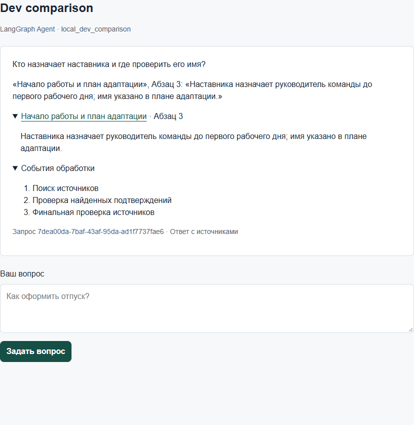
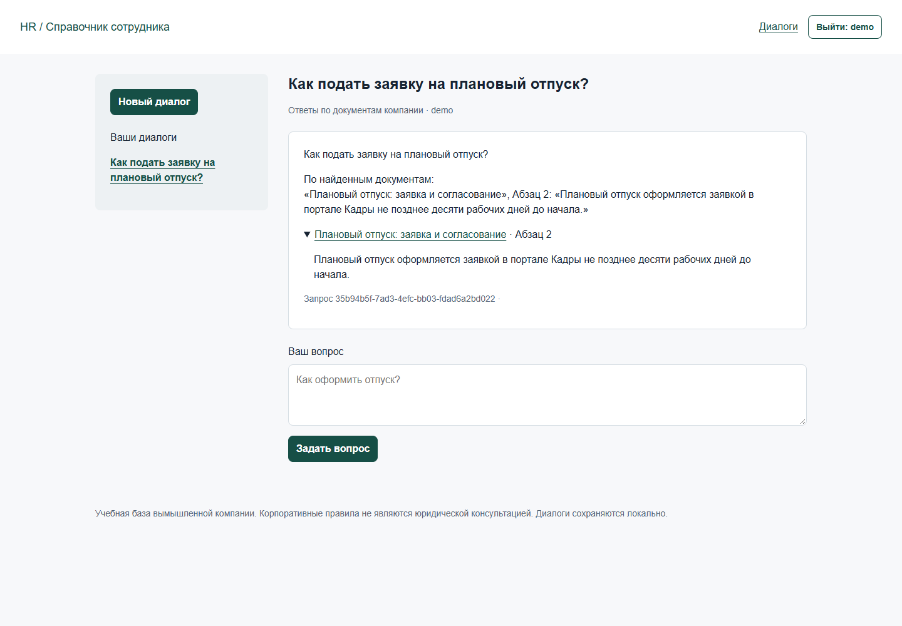
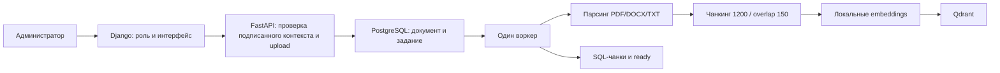
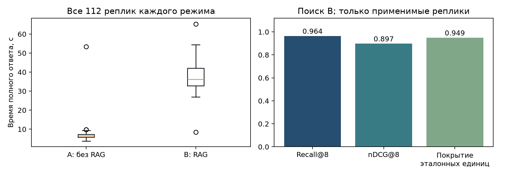
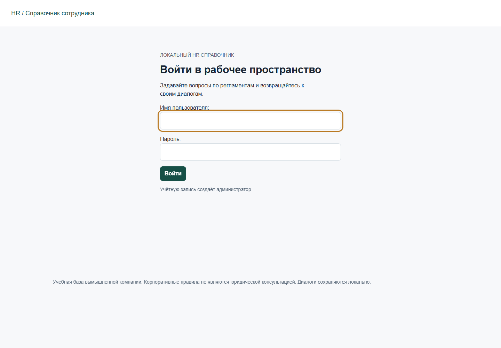
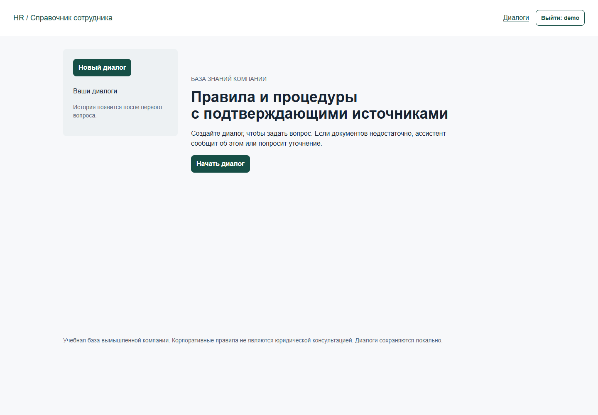

# AI-HR-Agent

Локальный HR-справочник по документам вымышленной IT-компании «Кедр Софт»: сотрудник задаёт вопрос, получает выдержки регламентов с источниками либо уточнение/сообщение о недостатке найденных сведений.

**Ветка HR_Agent:** реализованы исправленный conversational RAG и экспериментальный агент на настоящем LangGraph. Локальная LLM выбирает разрешённые поиск/чтение/ответ/уточнение/отказ. Main сохраняет первый этап. Hybrid retrieval и reranker не добавлены.

[Архитектура и ограничения агента](docs/agent-design.md) · [Фактические dev-результаты](docs/agent-results.md)

[Аудит восстановления поиска и состояния диалога](docs/agent-v2-audit.md)





*Реальный локальный интерфейс; источник раскрывается под ответом. Скриншот демонстрирует приложение, а не доказывает точность на бенчмарке.*

## Оглавление

- [Задача и возможности](#задача-и-возможности)
- [Соответствие РГР](#соответствие-ргр)
- [Стек](#стек)
- [Архитектура](#архитектура)
- [Корпус и бенчмарк](#корпус-и-бенчмарк)
- [Эксперименты](#эксперименты)
- [Запуск с нуля](#запуск-с-нуля)
- [Проверки и примеры](#проверки-и-примеры)
- [Структура](#структура)
- [Ограничения и развитие](#ограничения-и-развитие)
- [Источники](#источники)

## Задача и возможности

Отпуска, командировки, компенсации, оборудование, адаптация и внутренние обращения. Загрузка TXT, текстовых PDF и DOCX; очередь обработки; dense-поиск; преобразование продолжения в поисковый запрос локальной LLM; диалоги и источники. OCR и кадровые транзакции отсутствуют.

Пользователь видит только свои диалоги. Сервер проверяет владельца до тяжёлого запроса. Административные загрузка/удаление проверяют роль; удаляемые документы скрываются до физической очистки. Django передаёт FastAPI краткоживущий подписанный контекст с методом и путём. Стадии запроса и ошибки сохраняются локально; предыдущие ответы не служат доказательствами корпоративных фактов.

## Соответствие РГР

Учебный вариант 116: документы HR, семантический поиск и векторная БД, генерация с контекстом, многопользовательский веб-интерфейс, логирование, экспериментальное сравнение LLM без документов и RAG. Это описание реализации требований; исходные учебные PDF и внутренние материалы задания не распространяются.

## Стек

| Компонент | Назначение и выбор |
|---|---|
| Django | Сессии, интерфейс, ORM, миграции и административная панель |
| FastAPI | Обработка загрузки, поиск и генерация; общий прикладной слой |
| PostgreSQL | Пользователи, документы, диалоги, диагностические записи и очередь заданий |
| Qdrant | Dense-поиск по векторам фрагментов |
| LangGraph 1.2.24 | StateGraph с условными переходами и ограниченными инструментами |
| Ollama | Локальная генерация Qwen3 4B Q4_K_M и EmbeddingGemma |
| Docker Compose | Совместный запуск приложения, БД, индекса и воркера |

## Архитектура

```mermaid
flowchart LR
 U[Вопрос] --> O[Проверка владельца диалога]
 O --> H[Ограниченная история и локальное преобразование]
 H --> K{Тема определена?}
 K -- нет --> CL[Уточнение]
 K -- да --> R[Embedding и dense TOP_K=8]
 R --> F[Проверка ready и бюджет контекста]
 CF -- обычный порядок --> V[Выбор прямых доказательств по вопросу]
 V --> G[При достаточности: краткий ответ]
 G --> X[Проверки точных цитат, значения и условий]
 X --> A[Ответ с названиями источников или отказ]
 F --> CF[Проверка ограниченного класса конфликтов]
 CF -- конфликт или уточнение --> A
 A --> L[Локальные логи стадий и исходной генерации]
```





История ограничена шестью парами и 4000 символами в пределах диалога. Явная новая тема сбрасывает прошлые условия. Неименованная альтернатива требует уточнения. При несовместимых применимых нормах нужны явная замена, дата действия или подтверждённый приоритет; score и дата загрузки приоритета не дают. Неустранимый конфликт показывает обе нормы и рекомендует HR. Проверка конфликтов ограничена кандидатами, а не всеми возможными противоречиями корпуса.

## Корпус и бенчмарк

Один опубликованный корпус: 41 учебный документ (37 TXT, 2 PDF, 2 DOCX), около 19,3 тысячи слов основного текста, 286 фрагментов при использованном парсинге. Это синтетические политики, не правила реального работодателя. Манифест содержит происхождение, области применения, даты и явные замены.

Основной бенчмарк: 285 реплик, 129 авторских групп, 10 диалогов. Дополнительный набор: 22 реплики, 16 групп, два диалога. Отсутствие пересечений ID групп между частями не доказывает смысловую независимость. Корпус общий, сценарии целевые, данные одного учебного автора. Эталоны и пометки dev/test не передаются генератору и не индексируются.

## Эксперименты

Новый этап: [отдельные dev-прогоны RAG против LangGraph](docs/agent-results.md), 13 + 4 реплики на разных версиях; это диагностика, не final test. Рост вызовов/задержек измерен, преимущество по качеству не установлено. Ниже сохранены **исторические** серии первого этапа.

Это офлайн-сравнение одинаковой локальной LLM без документов и полного conversational RAG-конвейера, **не классический A/B-тест**. Модель qwen3:4b, окно 4096, выход 700, temperature=0, seed=116; RAG TOP_K=8. Генератор — Vulkan GPU, EmbeddingGemma — CPU. Машина: i7-3770, RAM 16 GiB, RX570 4 GiB. Порядок режимов фиксированный, по одной серии. Остальные параметры и digests — в `experiments/*/configuration.json`.

| Серия | Режим | N | p50, с | p95, с |
|---|---|---:|---:|---:|
| series_112 | no_rag | 112 | 6.533 | 8.827 |
| series_112 | rag | 112 | 36.192 | 48.037 |
| holdout_22 | no_rag | 22 | 6.228 | 8.605 |
| holdout_22 | rag | 22 | 58.19 | 70.658 |




*Историческая серия series_112, qwen3:4b, Ollama 0.40.14, 4096/700, TOP_K=8. Слева N=112 в каждом режиме; справа только 98 применимых вопросов. Последний столбец — доля вопросов со всеми заданными единицами доказательств, не точность ответа. Источник: experiments/series_112/records.json и summary.json. Текущий код отличается от версии этой серии.*

Источник каждой строки — `experiments/<серия>/records.json`. `python tools/verify_results.py` пересчитывает задержки и проверяет компактные данные. Режим no_rag — без документов, rag — включая преобразование, поиск и защитные проверки. В ранней серии Ollama 0.40.14, в holdout 0.40.16; прямое сравнение улучшений между сериями некорректно.

**Текущий код отличается от кода обеих исходных серий.** Эти сохранённые числа нельзя обещать воспроизвести текущим кодом. Публикуются компактные исходные результаты для проверки таблиц, а не полный закрытый snapshot прежнего окружения. Новый локальный запуск оценивает текущую версию отдельно: `python tools/run_with_profile.py tools/evaluate_public.py --limit-groups 1`. Для предварительных локальных баллов: `python tools/run_with_profile.py tools/score_public.py runtime/experiments/<ID>/answers.jsonl`; судья не считается откалиброванным. Просмотренные наборы уже используются для диагностики, не для независимого test и не для подбора параметров.

Диагностические исправления сохранены в `experiments/diagnostic_summary.json`; это целевые повторные проверки разных версий, не единое новое сравнение. Проверка значения и роли плательщика может отклонить смежную цитату, но не устраняет ошибку поиска.

Предварительная локальная оценка: 67 ответов (44 исходных, 23 диагностических), judge qwen3:4b — та же модель, что генератор, окно оценщика 6144. Судья ранее не прошёл калибровку; баллы и основания в `experiments/preliminary_llm.json` не являются доказанной точностью. Он завышал оценки известных проблемных ответов. Частичная человеческая проверка: 6 ответов, только покрытие L и действие P; расхождения с LLM 3/6 и 2/6. Другие человеческие шкалы не заполнены, три пары не калибруют судью. Агрегат — `experiments/human_partial_summary.json`; личные review-таблицы не публикуются.

Полный корпус занимает 53 431 токен использованного токенизатора до резервов и не помещается в настроенное окно 4096. Это ограничение данной конфигурации, а не всех локальных моделей. Усечённый «полный контекст» не выдавался за отдельный эксперимент.

## Запуск с нуля

Требуются Python 3.13, Docker Compose и Ollama. Проверенная конфигурация — Windows, 16 GiB RAM и RX570 4 GiB (Vulkan). CPU-вариант требует изменения `MODEL_GPU_LAYERS=0`, его скорость здесь не измерена. Полная проверка всех ОС на чистом компьютере не заявляется.

```bash
git clone --branch HR_Agent https://github.com/GodwynCornelia/AI-HR-Agent.git
cd AI-HR-Agent
python -m venv .venv
# Windows: .venv\Scripts\activate ; Linux/macOS: source .venv/bin/activate
python -m pip install -r requirements.lock.txt
python tools/setup_local.py
ollama pull qwen3:4b
ollama pull embeddinggemma
python tools/fetch_tokenizer.py
docker compose up -d --build
docker compose exec web python manage.py migrate
docker compose exec web python manage.py createsuperuser --username local_admin
docker compose exec web python manage.py seed_corpus --admin local_admin
```

Ollama должен работать до старта генерации (`ollama serve`, если сервер ещё не запущен). Для проверенного Windows/Vulkan-варианта: `python tools/ensure_ollama.py --vulkan`. В контейнерах используется host.docker.internal:11434. На Linux потребуется доступный контейнерам адрес Ollama; настройте OLLAMA_URL и сетевую привязку сервера в своей среде. Токенизатор скачивается отдельно с официального Qwen/Qwen3-4B, веса не входят в Git. `setup_local.py` генерирует секреты локально и не перезаписывает существующую .env.

Воркер из Compose обработает 41 документ. Статус очереди и ready проверяются в `/admin/`. Если используете `index_all`, предварительно остановите постоянно работающий worker. Интерфейс: http://127.0.0.1:18000/ . Создайте обычного пользователя в административной панели, затем войдите под ним.

При создании диалога выберите «Обычный RAG» или «LangGraph Agent»; затем режим неизменяем. Для сравнения создайте два диалога. Наблюдаемые события доступны после завершения ответа.

При обновлении с main остановите web/api/worker, пересоберите образ, примените миграции (включая 0002) и только затем запустите сервисы. Не запускайте старый код с новой схемой БД:

```bash
docker compose stop web api worker
docker compose build
docker compose run --rm web python manage.py migrate
docker compose up -d
```

## Проверки и примеры

```bash
python tools/verify_results.py
python manage.py test assistant --noinput
```

Для тестов нужен доступный PostgreSQL и переменные .env; тестовая БД создаётся отдельно. Опубликованный набор исключает архивные проверки, зависевшие от внутренних материалов (`docs/test_selection.json`). Ветка HR_Agent: 70 тестов прошли на отдельной проверочной БД; добавлены ограничения инструментов, режимы и регрессии общих проверок. Историческая публикация main содержала 39 тестов. Исходные 54+19 проверок относились к полному рабочему комплекту; подробности отбора и проверки — `docs/verification.json`.



*Вход с учётной записью, созданной администратором.*



*Раздельные диалоги пользователя; опубликованы только учебные демонстрации.*

Удачный пример — ответ с прямой нормой о записи при временном тестировании приспособления. Известные ошибки: вместо описания оплаченных третьей стороной услуг находилась смежная процедура согласования; продолжение про адаптацию переходило к наставничеству; общие цитаты о ДМС подменяли сообщение об отсутствующем телефоне. Компактные реальные примеры исходного holdout — `experiments/examples.json`. Это иллюстрации ошибок, не выбранная оценка всей системы. [Руководство пользователя](docs/user-guide.md).

## Структура

```text
assistant/       прикладной слой, FastAPI, модели, проверки и тесты
hr_project/      Django-конфигурация
templates/      интерфейс
tools/          настройка, токенизатор, оценка, проверка результатов
config/         параметры без секретов
data/           один корпус и разметка бенчмарка
experiments/    компактные результаты отдельных серий
docs/           руководство, изображения, проверка публикации
```

## Ограничения и развитие

Небольшой синтетический корпус, один автор сценариев, ограниченные история и окно, одна серия каждого режима и некалиброванный судья. Нахождение всех доказательств, точная цитата и совпадение статуса не гарантируют правильность всего ответа. Возможны неполнота, неверная применимость и ненайденная норма. Справочник не выполняет кадровые транзакции и не заменяет специалиста.

LangGraph реализован в этой ветке как ограниченный read-only агент; наблюдаются ошибки восстановления темы и лишние вызовы. Следующий шаг — независимая оценка и улучшение этих ошибок. Hybrid retrieval и reranker остаются отдельными будущими экспериментами. Кадровых транзакций нет.

## Источники

- [RAG, Lewis et al.](https://arxiv.org/abs/2005.11401)
- [DPR, Karpukhin et al.](https://arxiv.org/abs/2004.04906)
- [Ollama Structured Outputs](https://docs.ollama.com/capabilities/structured-outputs)
- [Qwen3-4B](https://huggingface.co/Qwen/Qwen3-4B)
- [EmbeddingGemma](https://huggingface.co/google/embeddinggemma-300m)
- Атрибуция и условия учебных адаптаций — [THIRD_PARTY_NOTICES.md](THIRD_PARTY_NOTICES.md).

Общая лицензия кода владельцем не выбрана. Обязательные уведомления сторонних материалов сохранены.

<!-- portfolio-start -->

## Портфолио-эксперимент (31 сценарий, 35 реплик)

## Естественный поиск

| Режим | Реплики | Recall@8 (сумма/N) | Весь контекст | p50, с | p95, с | Поиски / чтения | LLM |
|---|---:|---:|---:|---:|---:|---:|---:|
| rag | 35 | 29.000/31 | 28/31 | 43.41 | 72.96 | 35/0 | 124 |
| agent | 35 | 29.000/31 | 30/31 | 58.75 | 154.49 | 44/0 | 196 |

Предварительная оценка qwen3:4b. Ручные отметки отсутствуют.

| Режим | Проверено моделью | Успех | Критические ошибки | Верное действие |
|---|---:|---:|---:|---:|
| rag | 34/35 | 22/35 | 0/34 | 32/34 |
| agent | 33/35 | 20/35 | 0/33 | 28/33 |

Попарно по полностью оценённым сценариям: {'equal': 26, 'rag_better': 2, 'agent_better': 1}.


## Контролируемые пробы

| Проба | Измеренный результат |
|---|---|
| Пустая первая выдача на dev | Оба режима отказали после одного поиска |
| Ручной вызов соседнего контекста | Добавлена норма о согласующих командировку, оценка покрыла обе части |

[Методика](docs/portfolio-evaluation.md) · [Результаты](experiments/portfolio/final_results.md)

<!-- portfolio-end -->
