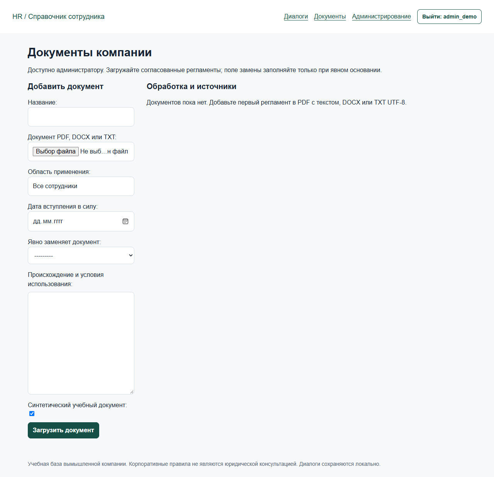

# Локальный HR-ассистент по внутренним регламентам

**Расчётно-графическая работа. Вариант 116. Разработка нейросетевого ассистента**

Выполнил: Fedor

## Содержание

1. [Введение](#vvedenie)
2. [Архитектура системы](#arhitektura)
3. [Установка и развёртывание](#razvertyvanie)
4. [Тестирование и результаты](#testirovanie)
5. [Заключение](#zakluchenie)
6. [Приложение. Руководство пользователя](#prilozhenie)

<a id="vvedenie"></a>

## 1. Введение

### 1.1. Цель работы

Цель работы — разработать локального ассистента, который отвечает на вопросы сотрудников по внутренним правилам организации, и сравнить его с той же языковой моделью без доступа к документам.

### 1.2. Предметная область

В работе рассматриваются регламенты вымышленной IT-компании «Кедр Софт». Они описывают оформление отпусков и командировок, компенсацию расходов, выдачу техники и адаптацию сотрудников. Применимое правило зависит от условий вопроса. Например, при оформлении командировки нужно различать согласование поездки и возмещение расходов, а условия компенсации могут зависеть от формата работы.

### 1.3. Задачи разработки

Для решения задачи подготовлен учебный корпус и реализована обработка файлов PDF, DOCX и TXT. Извлечённый текст разбивается на фрагменты и индексируется. При ответе найденные выдержки передаются локальной модели. Веб-приложение поддерживает учётные записи, отдельные диалоги и просмотр источников.

<a id="arhitektura"></a>

## 2. Архитектура системы

### 2.1. Назначение компонентов

| Компонент | Назначение |
|---|---|
| Django | Веб-интерфейс, авторизация и административная панель |
| FastAPI | Загрузка документов, поиск и обработка вопросов |
| PostgreSQL | Учётные записи, история диалогов, фрагменты документов и очередь обработки |
| Qdrant | Хранение векторов и семантический поиск |
| Ollama | Запуск Qwen3 4B для генерации и EmbeddingGemma для векторизации |

### 2.2. Подготовка базы знаний

Загруженный администратором документ поступает в очередь. Обработчик извлекает текст, делит его на фрагменты до 1200 символов с перекрытием 150 символов и вычисляет векторы. С фрагментом сохраняются название документа и место в тексте, например номер страницы PDF. Документ попадает в поиск после успешной обработки.

| Показатель | Значение |
|---|---:|
| Документы | 41 |
| Распределение по форматам | 37 TXT, 2 PDF, 2 DOCX |
| Объём основного текста | около 19,3 тыс. слов |
| Фрагменты после обработки | 286 |

### 2.3. Обработка вопроса

Сервер проверяет владельца диалога и передаёт модели не более шести предыдущих пар сообщений в пределах 4000 символов. Если вопрос ссылается на сказанное ранее, модель формулирует самостоятельный запрос. Вектор запроса сопоставляется с индексом, из которого извлекается до восьми фрагментов.

Из найденного текста выбираются подтверждающие выдержки. При подготовке ответа проверяются ссылки и значения, существенные для вопроса. Если применимость правила зависит от условий сотрудника, система запрашивает уточнение. При противоречии учитываются область действия, дата вступления в силу и явная замена регламента. Если выбрать действующее положение по документам невозможно, ответ приводит обе нормы и предлагает обратиться в HR.

<a id="razvertyvanie"></a>

## 3. Установка и развёртывание

### 3.1. Подготовка окружения

Для запуска требуются Python 3.13, Docker Compose и Ollama. Команды выполняются из корня репозитория.

```bash
git clone --branch main https://github.com/GodwynCornelia/AI-HR-Agent.git
cd AI-HR-Agent
python -m venv .venv
```

В PowerShell окружение активируется командой `.\.venv\Scripts\Activate.ps1`. В Bash используется `source .venv/bin/activate`.

```bash
python -m pip install -r requirements.lock.txt
python tools/setup_local.py
ollama pull qwen3:4b
ollama pull embeddinggemma
python tools/fetch_tokenizer.py
```

Если Ollama ещё не запущена, в отдельном терминале выполняется `ollama serve`. Для Windows проверен запуск на Vulkan через `python tools/ensure_ollama.py --vulkan`. Для работы на CPU в `config/experiment.env` задаётся `MODEL_GPU_LAYERS=0`. Контейнеры обращаются к Ollama через `host.docker.internal:11434`. В среде Linux следует указать адрес Ollama, доступный контейнерам.

### 3.2. Запуск и заполнение базы

```bash
docker compose up -d --build
docker compose exec web python manage.py migrate
docker compose exec web python manage.py createsuperuser --username local_admin
docker compose exec web python manage.py seed_corpus --admin local_admin
```

После загрузки корпуса обработчик формирует индекс в фоновом режиме. Состояние документов можно проверить в административной панели по адресу `http://127.0.0.1:18000/admin/`.

<a id="testirovanie"></a>

## 4. Тестирование и результаты

### 4.1. Функциональные проверки

В учебной версии пройдено 39 тестов. Проверялись авторизация, доступ к диалогам, загрузка документов и обработка ответа. В браузере выполнены вход, открытие диалога и просмотр источника под ответом.

### 4.2. Методика эксперимента

Одни и те же вопросы подавались модели в двух режимах: без базы знаний и с поиском по документам. Использовалась Qwen3 4B Q4_K_M с окном 4096 токенов, ограничением ответа в 700 токенов и температурой 0. Эксперименты выполнены на компьютере с Intel Core i7-3770, 16 ГиБ оперативной памяти и Radeon RX 570 4 ГиБ. В основной серии использовалась Ollama 0.40.14, в дополнительной — 0.40.16.

### 4.3. Результаты сравнения

| Серия | Режим | Ответов | Медиана, с | 95-й процентиль, с |
|---|---|---:|---:|---:|
| Основная | Без документов | 112 | 6,53 | 8,83 |
| Основная | RAG | 112 | 36,19 | 48,04 |
| Дополнительная | Без документов | 22 | 6,23 | 8,61 |
| Дополнительная | RAG | 22 | 58,19 | 70,66 |

Поиск оценивался на вопросах с размеченными подтверждающими фрагментами. Recall@8 показывает долю найденных эталонных доказательств, а nDCG@8 учитывает их положение в выдаче.

| Серия | Вопросов с доказательствами | Recall@8 | nDCG@8 | Найдены все доказательства |
|---|---:|---:|---:|---:|
| Основная | 98 | 0,964 | 0,897 | 93 из 98 |
| Дополнительная | 19 | 0,895 | 0,845 | 17 из 19 |

### 4.4. Анализ результатов

Поиск даёт материал, по которому можно проверить ответ, но итог зависит также от отбора выдержек и пересказа. В одном из успешных примеров ассистент нашёл прямое правило о фиксации результатов при временном тестировании приспособления. Среди ошибок наблюдались подмена порядка оплаты смежной процедурой и потеря темы при продолжении разговора об адаптации рабочего места.

Время ответа с RAG в обеих сериях выше: в него входят подготовка запроса, поиск и проверка ответа. Поисковые показатели характеризуют выдачу, а полнота и смысловая корректность ответа требуют отдельной оценки. При частичной ручной проверке шести ответов оценки модели разошлись с оценками человека в трёх случаях по полноте и в двух по выбору действия. Поэтому оценки локальной модели использованы для предварительного разбора ошибок. Показатели двух серий относятся к конфигурациям, на которых они были получены.

Сводные таблицы можно пересчитать по сохранённым записям:

```bash
python tools/verify_results.py
```

<a id="zakluchenie"></a>

## 5. Заключение

Разработан локальный многопользовательский HR-справочник с загрузкой документов, семантическим поиском и ответами с источниками. В основной серии все требуемые фрагменты были найдены в 93 из 98 вопросах с доказательствами. Медианное время ответа при использовании базы знаний составило 36,19 с. Основные направления улучшения связаны с полнотой составных ответов и сохранением темы в многошаговых диалогах.

<a id="prilozhenie"></a>

## Приложение. Руководство пользователя

### А.1. Вход и создание диалога

Администратор создаёт учётную запись сотрудника в панели Django. После входа по адресу `http://127.0.0.1:18000/` сотруднику доступны его диалоги. Для отдельного вопроса по другой теме можно создать новый диалог.


### А.2. Вопрос и проверка ответа

В поле сообщения вводится вопрос, например «Кто назначает наставника и где проверить его имя?». Если система спрашивает формат работы или другое условие, его следует сообщить в том же диалоге. Под ответом раскрывается выдержка с названием документа и местом цитаты.


### А.3. Загрузка документа

В учётной записи администратора нужно открыть раздел «Документы», заполнить форму «Добавить документ», выбрать PDF с текстовым слоем, DOCX или TXT и нажать «Загрузить документ». После обработки документ получает статус «Готов», и его фрагменты становятся доступны для поиска.



Условия использования материалов корпуса приведены в [уведомлении об источниках](THIRD_PARTY_NOTICES.md).
