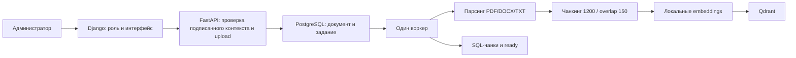

# AI-HR-Agent — локальный HR-справочник

**Расчётно-графическая работа · вариант 116 · разработка нейросетевого ассистента**

Приложение отвечает на вопросы сотрудников вымышленной компании «Кедр Софт» по локальной базе регламентов. Оно ищет нужные выдержки, показывает источники и запрашивает уточнение, если ответ зависит от неизвестного условия.


## Содержание

1. [Введение и соответствие заданию](#introduction)
2. [Архитектура и база знаний](#architecture)
3. [Установка и запуск](#setup)
4. [Тестирование и результаты](#evaluation)
5. [Заключение](#conclusion)
6. [Приложение: руководство пользователя](#guide)

<a id="introduction"></a>

## 1. Введение

**Цель работы** — реализовать многопользовательский справочник с семантическим поиском и проверить, как документы влияют на ответы локальной языковой модели.

| Сценарий | Что делает справочник |
|---|---|
| Отпуск или командировка | Ищет порядок оформления, сроки и подтверждающие документы |
| Компенсации и оборудование | Учитывает условия вопроса, запрашивает формат работы, если он меняет ответ |
| Адаптация и поддержка | Указывает действия, ответственных и источник |
| Продолжение диалога | Преобразует короткую отсылку в самостоятельный поисковый вопрос |

### Соответствие заданию

| Требование | Реализация | Где проверить |
|---|---|---|
| PDF, DOCX и TXT | Извлечение текста и разбиение на перекрывающиеся фрагменты | [parsing.py](assistant/parsing.py) |
| Векторная БД и семантический поиск | EmbeddingGemma и Qdrant | [vector.py](assistant/vector.py), [services.py](assistant/services.py) |
| Локальная генерация по документам | Qwen3 через Ollama, выбор выдержек и контроль ссылок | [inference.py](assistant/inference.py), [evidence.py](assistant/evidence.py) |
| Веб-интерфейс для нескольких пользователей | Сессии Django, проверка владельца диалога и роли администратора | [views.py](assistant/views.py), [security.py](assistant/security.py) |
| Логирование | PostgreSQL хранит исходный и поисковый запросы, ответ и диагностику | [models.py](assistant/models.py), [services.py](assistant/services.py) |
| Развёртывание и оценка | Docker Compose, тесты и эксперимент LLM без документов против RAG | [compose.yaml](compose.yaml), [verify_results.py](tools/verify_results.py) |

<a id="architecture"></a>

## 2. Архитектура и база знаний

### Распределение ответственности

| Компонент | Назначение и выбор |
|---|---|
| Django | Сессии, интерфейс, ORM, миграции и административная панель |
| FastAPI | Обработка загрузки, поиск и генерация; общий прикладной слой |
| PostgreSQL | Пользователи, документы, диалоги, диагностические записи и очередь заданий |
| Qdrant | Dense-поиск по векторам фрагментов |
| Ollama | Локальная генерация Qwen3 4B Q4_K_M и EmbeddingGemma |
| Docker Compose | Совместный запуск приложения, БД, индекса и воркера |

### Обработка документов и вопроса

```mermaid
flowchart LR
 U[Вопрос] --> O[Проверка владельца диалога]
 O --> H[Ограниченная история и локальное преобразование]
 H --> K{Тема определена?}
 K -- нет --> CL[Уточнение]
 K -- да --> R[Embedding и dense TOP_K=8]
 R --> F[Проверка ready и бюджет контекста]
 CF -- обычный порядок --> G[Проект ответа и ID выдержек]
 G --> V[Выбор прямых доказательств по вопросу]
 V --> X[Проверки точных цитат, значения и условий]
 X --> A[Ответ с названиями источников или отказ]
 F --> CF[Проверка ограниченного класса конфликтов]
 CF -- конфликт или уточнение --> A
 A --> L[Локальные логи стадий и исходной генерации]
```





История ограничена шестью парами и 4000 символами в пределах диалога. Явная новая тема сбрасывает прошлые условия. Неименованная альтернатива требует уточнения. При несовместимых применимых нормах нужны явная замена, дата действия или подтверждённый приоритет; score и дата загрузки приоритета не дают. Неустранимый конфликт показывает обе нормы и рекомендует HR. Проверка конфликтов ограничена кандидатами, а не всеми возможными противоречиями корпуса.

Проверка доступа выполняется до обработки запроса. Django передаёт FastAPI подписанный контекст. Удаляемые документы скрываются из выдачи до очистки индекса.

### Учебный корпус и контрольные вопросы

Один опубликованный корпус: 41 учебный документ (37 TXT, 2 PDF, 2 DOCX), около 19,3 тысячи слов основного текста, 286 фрагментов при использованном парсинге. Это синтетические политики, не правила реального работодателя. Манифест содержит происхождение, области применения, даты и явные замены.

Основной бенчмарк: 285 реплик, 129 авторских групп, 10 диалогов. Дополнительный набор: 22 реплики, 16 групп, два диалога. Отсутствие пересечений ID групп между частями не доказывает смысловую независимость. Корпус общий, сценарии целевые, данные одного учебного автора. Эталоны и пометки dev/test не передаются генератору и не индексируются.

<a id="setup"></a>

## 3. Установка и запуск

Требуются Python 3.13, Docker Compose и Ollama. Проверенная конфигурация — Windows, 16 GiB RAM и RX570 4 GiB (Vulkan). CPU-вариант требует изменения `MODEL_GPU_LAYERS=0`, его скорость здесь не измерена. Полная проверка всех ОС на чистом компьютере не заявляется.

```bash
git clone --branch main https://github.com/GodwynCornelia/AI-HR-Agent.git
cd AI-HR-Agent
python -m venv .venv
# Windows: .venv\Scripts\activate ; Linux/macOS: source .venv/bin/activate
python -m pip install -r requirements.lock.txt
python tools/setup_local.py
ollama pull qwen3:4b
ollama pull embeddinggemma
python tools/fetch_tokenizer.py
docker compose up -d --build
docker compose exec web python manage.py migrate
docker compose exec web python manage.py createsuperuser --username local_admin
docker compose exec web python manage.py seed_corpus --admin local_admin
```

Ollama должен работать до старта генерации (`ollama serve`, если сервер ещё не запущен). Для проверенного Windows/Vulkan-варианта: `python tools/ensure_ollama.py --vulkan`. В контейнерах используется host.docker.internal:11434. На Linux потребуется доступный контейнерам адрес Ollama; настройте OLLAMA_URL и сетевую привязку сервера в своей среде. Токенизатор скачивается отдельно с официального Qwen/Qwen3-4B, веса не входят в Git. `setup_local.py` генерирует секреты локально и не перезаписывает существующую .env.

Воркер из Compose обработает 41 документ. Статус очереди и ready проверяются в `/admin/`. Если используете `index_all`, предварительно остановите постоянно работающий worker, чтобы один обработчик управлял очередью. Индекс и БД создаются с нуля; готовые дампы и пароли не нужны. Интерфейс: http://127.0.0.1:18000/ . Создайте обычного пользователя в административной панели, затем войдите под ним.

### Структура репозитория

```text
assistant/       прикладной слой, FastAPI, модели, проверки и тесты
hr_project/      Django-конфигурация
templates/      интерфейс
tools/          настройка, токенизатор, оценка, проверка результатов
config/         параметры без секретов
data/           один корпус и разметка бенчмарка
experiments/    компактные результаты отдельных серий
docs/           руководство, изображения, проверка публикации
```

<a id="evaluation"></a>

## 4. Тестирование и результаты

### Проверки и пересчёт

```bash
python tools/verify_results.py
python manage.py test assistant --noinput
```

Для тестов нужен доступный PostgreSQL и переменные .env; тестовая БД создаётся отдельно. Опубликованный набор исключает архивные проверки, зависевшие от внутренних материалов (`docs/test_selection.json`). Публичный набор: 39 тестов, прошли на отдельной проверочной БД. Исходные 54+19 проверок относились к полному рабочему комплекту; подробности отбора и проверки — `docs/verification.json`.

### Сравнение локальной модели без документов и RAG

Это офлайн-сравнение одинаковой локальной LLM без документов и полного conversational RAG-конвейера, **не классический A/B-тест**. Модель qwen3:4b, окно 4096, выход 700, temperature=0, seed=116; RAG TOP_K=8. Генератор — Vulkan GPU, EmbeddingGemma — CPU. Машина: i7-3770, RAM 16 GiB, RX570 4 GiB. Порядок режимов фиксированный, по одной серии. Остальные параметры и digests — в `experiments/*/configuration.json`.

| Серия | Режим | N | p50, с | p95, с |
|---|---|---:|---:|---:|
| series_112 | no_rag | 112 | 6.533 | 8.827 |
| series_112 | rag | 112 | 36.192 | 48.037 |
| holdout_22 | no_rag | 22 | 6.228 | 8.605 |
| holdout_22 | rag | 22 | 58.19 | 70.658 |


*Историческая серия series_112, qwen3:4b, Ollama 0.40.14, 4096/700, TOP_K=8. Слева N=112 в каждом режиме; справа только 98 применимых вопросов. Последний столбец — доля вопросов со всеми заданными единицами доказательств, не точность ответа. Источник: experiments/series_112/records.json и summary.json. Текущий код отличается от версии этой серии.*

Записи для пересчёта: [исходная серия](experiments/series_112/records.json) и [дополнительная серия](experiments/holdout_22/records.json). `python tools/verify_results.py` пересчитывает задержки и проверяет компактные данные. Режим no_rag — без документов, rag — включая преобразование, поиск и защитные проверки. В ранней серии Ollama 0.40.14, в holdout 0.40.16; прямое сравнение улучшений между сериями некорректно.

**Текущий код отличается от кода обеих исходных серий.** Эти сохранённые числа нельзя обещать воспроизвести текущим кодом. Публикуются компактные исходные результаты для проверки таблиц, а не полный закрытый snapshot прежнего окружения. Новый локальный запуск оценивает текущую версию отдельно: `python tools/run_with_profile.py tools/evaluate_public.py --limit-groups 1`. Для предварительных локальных баллов: `python tools/run_with_profile.py tools/score_public.py runtime/experiments/<ID>/answers.jsonl`; судья не считается откалиброванным. Просмотренные наборы уже используются для диагностики, не для независимого test и не для подбора параметров.

Диагностические исправления сохранены в `experiments/diagnostic_summary.json`; это целевые повторные проверки разных версий, не единое новое сравнение. Проверка значения и роли плательщика может отклонить смежную цитату, но не устраняет ошибку поиска.

Предварительная локальная оценка: 67 ответов (44 исходных, 23 диагностических), judge qwen3:4b — та же модель, что генератор, окно оценщика 6144. Судья ранее не прошёл калибровку; баллы и основания в `experiments/preliminary_llm.json` не являются доказанной точностью. Он завышал оценки известных проблемных ответов. Частичная человеческая проверка: 6 ответов, только покрытие L и действие P; расхождения с LLM 3/6 и 2/6. Другие человеческие шкалы не заполнены, три пары не калибруют судью. Агрегат — `experiments/human_partial_summary.json`; личные review-таблицы не публикуются.

Полный корпус занимает 53 431 токен использованного токенизатора до резервов и не помещается в настроенное окно 4096. Это ограничение данной конфигурации, а не всех локальных моделей. Усечённый «полный контекст» не выдавался за отдельный эксперимент.

<a id="conclusion"></a>

## 5. Заключение

Реализован локальный справочник с поиском по регламентам, историей диалога, уточнением условий и проверяемыми выдержками. Эксперимент показывает измеренную стоимость поиска и проверок в секундах; полноту и смысловую точность оценивают отдельно.

Качество зависит от покрытия корпуса, релевантности найденных фрагментов и возможностей модели. Известны пропуски частей вопроса, ошибки применимости и потеря темы в продолжениях. Примеры сохранены в [experiments/examples.json](experiments/examples.json). Учебная версия охватывает текстовые документы и справочные ответы.

<a id="guide"></a>

## Приложение. Руководство пользователя

1. Администратор создаёт учётную запись и при необходимости загружает регламент. Статус обработки виден в панели управления.
2. Сотрудник входит в систему, открывает новый диалог и задаёт вопрос.
3. Под ответом можно раскрыть выдержку и проверить документ и место цитаты. Если система запросила уточнение, сообщите недостающее условие в том же диалоге.


Полный порядок действий приведён в [руководстве пользователя](docs/user-guide.md).

## Источники

- [RAG, Lewis et al.](https://arxiv.org/abs/2005.11401)
- [DPR, Karpukhin et al.](https://arxiv.org/abs/2004.04906)
- [Ollama Structured Outputs](https://docs.ollama.com/capabilities/structured-outputs)
- [Qwen3-4B](https://huggingface.co/Qwen/Qwen3-4B)
- [EmbeddingGemma](https://huggingface.co/google/embeddinggemma-300m)
- Атрибуция и условия учебных адаптаций — [THIRD_PARTY_NOTICES.md](THIRD_PARTY_NOTICES.md).

Общая лицензия кода владельцем не выбрана. Обязательные уведомления сторонних материалов сохранены.
