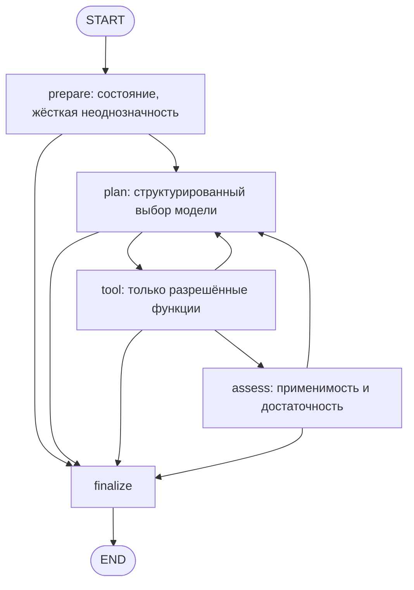

# LangGraph Agent: экспериментальная ветка HR_Agent

Актуальные переходы после пустой выдачи, чтение соседних фрагментов и оценка частей вопроса описаны в [аудите улучшений](agent-v2-audit.md). Ниже сохранено описание исходной архитектуры.

Ветка сохраняет два режима: исправленный обычный dense conversational RAG и один агентный граф. Main остаётся историческим локальным RAG. Агент не выполняет кадровых/финансовых операций и не подключается к порталам компании.

## Общая основа сравнения

Устранён дефект композиции: выбор цитаты после numeric_requirement_check мог вернуть answer без запрошенного числового значения. Обязательные проверки применяются после выбора доказательств и к окончательному результату обоих режимов. Отдельная регрессия проверяет обычный RAG и граф. Реальная сумма/срок и явное «не установлено» остаются допустимыми доказательствами.

Старый линейный путь генерировал проект, который затем заменялся цитатами. Теперь оба режима используют общий `grounded.py`: выбор подтверждений → при достаточности краткий текст → проверка ссылок и один ограниченный контроль пересказа → финальные обязательные ограничения. Если подтверждений мало, не запускается бесполезная генерация полного ответа. Проверка той же слабой моделью не считается независимым доказательством правильности; отрицательный/недоступный контроль допускает ограниченный цитатный fallback.

Подготовка ограниченной истории и начального самостоятельного вопроса общая. Для ясных отсылок допускается одна дополнительная структурированная попытка разрешения предмета и действия. Прошлые ответы модели не являются фактами. Неназванный «другой вариант» требует уточнения. При явном новом предмете старые условия не должны переноситься; качество этого преобразования остаётся измеряемым ограничением модели.

## Реальный граф

Используется установленный и зафиксированный LangGraph 1.2.24, `StateGraph` и условные рёбра. API проверен по установленной версии и [официальной документации](https://docs.langchain.com/oss/python/langgraph/graph-api).

`plan` действительно вызывает локальную модель и выбирает search/read/answer/clarify/refuse. Это валидируемый JSON, а не нативный Ollama tool calling и не фиксированная последовательность трёх поисков. Сервер исполняет только допустимое действие. После достаточного результата модель может завершить; до поиска может уточнить или отказаться. Мягкое предварительное уточнение можно пересмотреть по ясному контексту, но структурно неопределённая альтернатива завершает запрос без догадки.

Для чистоты сравнения первый непустой поисковый вопрос берётся из общей подготовки RAG и не меняется контроллером. Это ограничение аргумента первого поиска, не обязательное выполнение поиска. Последующие запросы выбирает модель по недостающим подтверждениям. Одинаковый вызов не исполняется повторно: допускается одна попытка контроллера выбрать другое действие после сообщения о дубликате; затем остановка. Другой запрос без новых фрагментов завершает переформулировки. Повторное чтение блокируется; неизменённый прочитанный текст не запускает заново ту же оценку достаточности.

## Инструменты

| Инструмент | Вход | Серверное ограничение |
|---|---|---|
| search_policies | query, до 900 символов | Тот же dense retriever, embeddings и TOP_K=8; только ready-чанки |
| read_policy_fragment | UUID ранее возвращённого и сохранённого в состоянии чанка | Проверка allowlist и ready при чтении; полный SQL-фрагмент, не файл по произвольному пути |

Инструменты не получают эталоны/категории, не исполняют shell и не вызывают внешние HR-системы. Документы и ответы инструментов недоверенны. Удаляемый документ исключается из новых результатов; доступность источников проверяется перед итоговой выдачей. Нельзя выбрать инструмент или изменить право инструкцией внутри документа.

## Состояние, память и границы

Состояние содержит исходное сообщение, разрешённый вопрос/тему, пользовательские условия в хронологии, запросы, стабильные UUID текущего индекса, найденные/прочитанные фрагменты, оценку подтверждений, действия, счётчики и итог. UUID стабильны в пределах актуального индекса; переиндексация может их заменить.

Память диалогов — существующие PostgreSQL Conversation/Turn. Второго хранилища, checkpointer и клиентского thread_id нет. Владелец проверяется сервером; выбранный при создании mode неизменяем, поэтому история разных режимов не смешивается.

По умолчанию максимум 3 поисковых исполнения, 8 решений контроллера и 600 секунд запроса. Технические узлы не равны действиям; recursion_limit = 4 × action_budget + 10 согласован с этим циклом. Максимум 8 документов и 16 удерживаемых чанков; текст ограничен CONTEXT_CHARS и токеновым окном. HTTP-запросы получают остаток deadline, Qdrant — ограниченный сетевой timeout; SQL имеет отдельные connect/statement/lock timeouts. Это кооперативный бюджет, не гарантия жёсткого realtime-прерывания любого инфраструктурного сбоя.

При бюджете/ошибке показывается подтверждённая часть с указанием неполноты либо честное техническое сообщение. Сбой не означает отсутствия правила в корпусе. Статус answer у частичного fallback сопровождается `partial=true`; его нельзя считать полным успехом.

## Применимость, конфликт, ответ

Явные несовместимые метаданные формата работы исключают неподходящие источники. Для конфликта дополнительно проверяются одна услуга, один предмет вопроса и одинаковые условия. Если совместная область требует неизвестного формата работы, сначала уточняется формат. Ограниченная проверка метаданных не является универсальным семантическим решателем всех условий.

Приоритет допускают только явные дата действия, замена и заранее заданный приоритет; title, upload и score не выбирают действующее правило. Неустранимое противоречие возвращает обе цитаты и HR. Дополнительные флаги и вердикты локальной модели всё ещё могут ошибаться; точность цитаты не гарантирует применимость или полноту.

После достаточных доказательств формируется краткий русский ответ. Пересказ проверяется один раз; неверные/неподтверждённые утверждения заменяются выбранными выдержками или отказом. Числовые значения, роли оплаты и точность ссылок не могут быть молча отменены последующим fallback.

## UI и трассы

Режим выбирается при создании диалога. После завершения доступны краткие наблюдаемые события: поиск, дополнительный поиск, чтение и проверка источников. Во время синхронного запроса используется существующий индикатор ожидания; realtime-стриминг событий не заявляется. Скрытые рассуждения и системные промпты не выводятся пользователю.

В защищённой локальной диагностике сохраняются версия графа/отпечаток кода, конфигурация, переходы, аргументы и сводки результатов инструментов (UUID/хеш/размер), времена, запросы, LLM-вызовы/доступные токены, причина остановки, проверки и fallback. Известные рабочие секреты и явные credential-строки редактируются в технической трассе. Рабочие диалоги не публикуются; в репозитории — только компактная синтетическая dev-диагностика и один обезличенный пример.

LangSmith/LangChain tracing принудительно выключен. Платные сервисы, hybrid, reranker, OCR, supervisor и мультиагентная система не добавлены.
