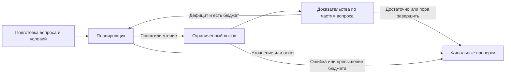

# Аудит улучшений HR_Agent

Исходная версия — f997bec. В dd16477 пустая выдача стала отдельным состоянием. В 807d6eb чтение стало получать до двух соседних чанков того же документа по ordinal, до 4000 символов за вызов и до двух вызовов. Исходный ID должен присутствовать среди удерживаемых результатов поиска. Итоговые цитаты сверяются с текущими ready-чанками. В 10d8c3b общий разбор запроса извлекает предмет, процедуру, действие, активные и заменённые условия с индексами пользовательских реплик, неизвестные условия и части вопроса. Граф использует разбор при выборе следующего действия. Оценка доказательств указывает покрытые части и различает поиск, соседний контекст и вопрос пользователю. При достаточной оценке с подтверждёнными частями и без уточнения граф сразу переходит к заключительным проверкам.

## Почему первая проба закончилась отказом

После нулевой выдачи планировщик увидел исходный самостоятельный вопрос, список уже сделанных запросов, пустой список результатов, состояние empty, одну попытку без прогресса и остаток в два поиска. Доступны были search_policies, clarify и refuse. Чтение и ответ были недоступны без источника. Missing содержал общее «применимые подтверждения». Две части были сформулированы в вопросе, но отсутствовали как отдельные цели поиска. Модель дословно предложила предыдущий запрос. Сервер заблокировал его, отправил обратную связь о повторе, затем модель выбрала refuse. Внутренний мотив модели по трассе определить нельзя.

В следующей итерации подсказка конкретизировала, что после пустой выдачи не проверена ни одна часть. Для непустой выдачи добавлена разбивка дефицита по частям. Повторный поиск остаётся выбором модели. При одинаково пустой первой выдаче на вопросах о поездке на обучение и о лимите обучения оба режима отказали после одного вызова поиска. Эти результаты вместе с исходной пробой подтверждают устойчивое ограничение выбора и переформулировки текущей модели. Следующий отдельный эксперимент — оценить формирование поискового запроса по указанной недостающей части на фиксированных входах, до интеграции альтернативной модели или стратегии.

## Диалог и проверка

В завершённом естественном прогоне ddd81707 оба режима запросили формат, показали конфликт по коворкингу, ответили на новый вопрос о гостинице и снова запросили уточнение при отсылке к сумме. Сохранены ответы и причины остановки. На четырёх репликах медианы RAG и агента составили 33,00 и 40,65 с, среднее число вызовов LLM — 3,50 и 4,75. Сценарий превышения лимита остаётся нерешённым относительно эталона. Структурированный разбор используется в текущем графе, его устойчивость по всей матрице диалоговых сценариев ещё предстоит измерить.

77 тестов прошли. Компонентные проверки подтверждают переход от пустой выдачи к второму поиску, получение доказательства из соседнего чанка, пределы повторов, чтения и действий, защиту доступа и пропуск повторного планирования после достаточной оценки. В живых пробах полезное дополнительное действие не подтверждено. Человеческих оценок нет.

На отдельном естественном вопросе о наставнике базовый RAG ответил за 41,8 с, агент отказал за 138,6 с. Агент сформулировал дефицит, но искал «Где проверить его имя» без предмета и сместил контекст к новым фрагментам. После этой пробы подтверждённые фрагменты получили приоритет при заполнении контекста. Эта правка требует нового живого измерения. Устойчивый рост качества и сокращение задержки пока не установлены.

Публичные записи, конфигурации и трассы учебных запросов находятся в experiments/agent_v2. Сводка пересчитывается командой `python tools/summarize_agent_v2.py`. Исходные agent_dev и новый аудит относятся к разным версиям. Инструкция запуска — README.md. Для локального повторения контролируемой пробы используйте `python tools/run_with_profile.py tools/probe_empty_search.py --case travel_learning`; задайте отдельную БД для диагностики.
