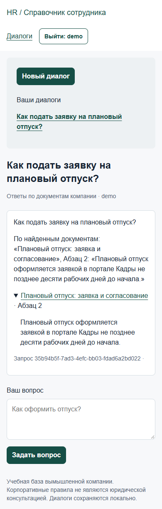

# Руководство пользователя

Войдите под учётной записью, созданной вашим администратором. Создайте диалог и задайте HR-вопрос. Продолжения используют только историю этого диалога; для ясной смены темы можно написать «Теперь другая тема: …». Проверяйте названия документов и цитаты. Уточнение требует назвать недостающее условие. Отказ означает недостаточность найденного контекста, а не отсутствие правила во всей организации.

Администратор загружает TXT, текстовый PDF или DOCX, задаёт область применения, дату действия и явную замену документа. Дождитесь состояния ready. Удалённый документ сразу скрывается из выдачи, физическую очистку завершает воркер. Ассистент не выполняет кадровых операций. В конфликтном ответе проверьте обе нормы и обратитесь к HR.

*Реальный мобильный вид того же демонстрационного диалога; интерфейс проверен без горизонтального переполнения.*
